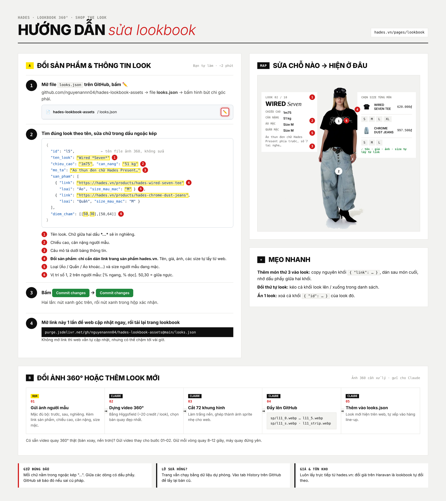

# HADES Lookbook 360 — hades.vn/pages/lookbook

## Đổi sản phẩm / thông tin look
1. Mở file **looks.json** → bấm ✏️ (Edit).
2. Tìm look theo `ten_look`, sửa chữ trong ngoặc kép:
   - `link`: link trang sản phẩm hades.vn → tên, giá, ảnh, size tự lấy từ web.
   - `loai`, `size_mau_mac`: loại món và size người mẫu mặc.
   - `chieu_cao`, `can_nang`, `mo_ta`, `ten_look` (chữ giữa `*…*` in nghiêng).
   - `diem_cham`: vị trí số 1, 2 trên người mẫu `[% ngang, % dọc]`.
3. Bấm **Commit changes** (2 lần).
4. Mở link để cập nhật ngay: https://purge.jsdelivr.net/gh/nguyenannn04/hades-lookbook-assets@main/looks.json

## Đổi ảnh 360° / thêm look mới
Gửi ảnh người mẫu (trước/sau/nghiêng) + link sản phẩm cho Claude. Ảnh 360 nằm trong thư mục `sp/` (`lX_0…5.webp`, `lX_s.webp`, `lX_strip.webp`).
